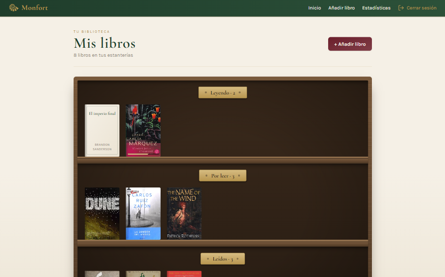

# Monfort

**Tu biblioteca personal.** Organiza tus libros en estanterías por estado de lectura, sigue tu progreso página a página y añade nuevos títulos buscándolos en Open Library.

**[Ver la demo →](https://monfort-biblioteca.vercel.app)**

> Pulsa **«Probar con la cuenta demo»** en la pantalla de acceso para entrar sin registrarte.
> El backend está en un plan gratuito que se duerme tras 15 minutos sin uso: **la primera carga puede tardar hasta un minuto** mientras el servidor despierta. Después funciona con normalidad.

<p align="center">
  
  
  
</p>

<p align="center">
  
</p>

## Funcionalidades

- **Estantería por estado**: tres baldas (Leyendo, Por leer, Leídos) con portadas y barra de progreso.
- **Búsqueda en Open Library** al añadir un libro, con autocompletado de título, autor, páginas y portada.
- **Progreso de lectura** con reglas automáticas: al empezar un libro pasa a «Leyendo», al llegar a la última página pasa a «Leído».
- **Edición y borrado** desde un _bottom sheet_ que se cierra arrastrando en móvil y como modal en escritorio.
- **Estadísticas**: libros por estado, páginas leídas y progreso medio.
- **Registro e inicio de sesión** con JWT, y cuenta demo de acceso inmediato.
- **Diseño mobile-first**: pensado para usarse en el móvil, con botón flotante para añadir libros y paneles que se cierran con gestos; en escritorio se adapta a pantalla ancha.

## Stack

| Capa          | Tecnologías                                                                     |
| ------------- | ------------------------------------------------------------------------------- |
| Frontend      | React, Vite, React Router, Tailwind CSS v4                                      |
| Backend       | Python 3.13, FastAPI, SQLAlchemy 2, Pydantic v2, JWT (python-jose), bcrypt      |
| Base de datos | PostgreSQL (Neon) en producción, SQLite en desarrollo                           |
| Tests         | pytest (TestClient de FastAPI, base de datos aislada y mocks de la API externa) |
| Despliegue    | Vercel (frontend), Render (backend), Neon (base de datos)                       |
| Herramientas  | uv, npm, ESLint, Prettier, GitHub (flujo con ramas y Pull Requests)             |

## Arquitectura

```
Navegador ──► Vercel (React estático) ──► Render (API FastAPI) ──► Neon (PostgreSQL)
                                                  │
                                                  └──► Open Library (búsqueda de libros)
```

El frontend es una SPA servida como archivos estáticos. Toda la lógica de negocio vive en la API: el frontend envía los cambios y muestra siempre la respuesta del servidor, que es la fuente de verdad.

## Decisiones técnicas

- **Reglas de negocio en el backend.** Las transiciones de estado (empezar un libro, terminarlo, «desleerlo») se resuelven en una función pura, `resolve_reading_progress`, compartida por la creación y la edición. Si el usuario elige un estado a mano, se respeta; si solo cambia la página, el estado se deduce.
- **PATCH real con `exclude_unset`.** El endpoint distingue entre un campo no enviado y un campo enviado a `null`, lo que permite, por ejemplo, quitar una portada. Los campos obligatorios no admiten `null`.
- **Validación en los dos lados.** El frontend avisa pronto (formularios con `required`, comprobaciones antes de enviar) y el backend valida siempre con Pydantic: URLs de portada `http/https`, títulos no vacíos, emails válidos y normalizados a minúsculas, contraseñas de 8 a 72 caracteres.
- **Ownership en todas las rutas.** Un usuario solo ve y modifica sus libros; acceder a un libro ajeno devuelve 404, igual que si no existiera, para no revelar qué ids existen.
- **Configuración por variables de entorno.** El mismo código funciona en local (SQLite, sin configuración) y en producción (PostgreSQL), y la app no arranca si falta la clave secreta.
- **Conexiones resistentes.** `pool_pre_ping` descarta las conexiones que Neon cierra al suspenderse por inactividad.
- **Aviso de arranque en frío.** Un hook propio, `useSlowHint`, muestra «Despertando el servidor…» si una petición tarda más de unos segundos.
- **Token en `localStorage`.** Es una decisión consciente por simplicidad; las cookies `httpOnly` serían más seguras frente a XSS y están en la lista de mejoras.

## Ejecutar en local

Requisitos: [uv](https://docs.astral.sh/uv/) y Node.js 20 o superior.

### Backend

```bash
cd backend
uv sync
cp .env.example .env        # y rellena SECRET_KEY
uv run uvicorn app.main:app --reload
```

La API queda en `http://localhost:8000`, con la documentación interactiva en `http://localhost:8000/docs`. Sin `DATABASE_URL`, usa un archivo SQLite local.

Para crear la cuenta demo con libros de ejemplo (se puede repetir para reiniciarla):

```bash
uv run python -m scripts.seed_demo
```

### Frontend

```bash
cd frontend
npm install
npm run dev
```

La app queda en `http://localhost:5173` y se conecta al backend local. Para apuntar a otro backend, define `VITE_API_URL`.

### Tests

```bash
cd backend
uv run pytest -v
```

## API

| Método | Ruta                   | Descripción                                               |
| ------ | ---------------------- | --------------------------------------------------------- |
| POST   | `/register`            | Crea una cuenta                                           |
| POST   | `/login`               | Devuelve un token JWT                                     |
| GET    | `/books`               | Lista los libros del usuario (filtro opcional por estado) |
| POST   | `/books`               | Añade un libro                                            |
| GET    | `/books/search?title=` | Busca en Open Library                                     |
| GET    | `/books/{id}`          | Detalle de un libro                                       |
| PATCH  | `/books/{id}`          | Actualiza un libro (parcial)                              |
| DELETE | `/books/{id}`          | Borra un libro                                            |
| GET    | `/stats`               | Estadísticas de lectura                                   |

## Próximas mejoras

- Refresh tokens y sesión en cookies `httpOnly`.
- Migraciones de base de datos con Alembic.
- Búsqueda en Open Library también por autor.
- Reutilizar el buscador de Open Library al editar la portada (hook `useOpenLibrarySearch`).

## Autor

**Adrián González Baamonde** · [GitHub](https://github.com/adrian-glez-baamonde)
